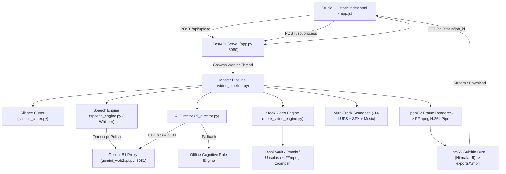

# CineForge AI

CineForge AI is a local-first autonomous video editing workstation that turns raw talking-head footage into vertical Shorts or widescreen edits with dead-air removal, multi-cam reframing, thematic motion B-roll, `-14 LUFS` audio mastering, and burned-in English/Hindi subtitles.

## Key Features

- **Adaptive Silence & Jump-Cut Assembly**: Measures mean audio volume via FFmpeg `volumedetect`, computes an adaptive silence threshold, and executes frame-accurate `trim`/`atrim`/`concat` ripple cuts.
- **Local Speech Transcription (English & Hindi)**: Runs OpenAI Whisper (`base` model on CUDA or CPU) with strict Latin ASCII and Devanagari Unicode filtering (`U+0900–U+097F`, `U+1CD0–U+1CFF`, `U+A8E0–U+A8FF`) plus optional Gemini transcript polishing.
- **Cognitive AI Director (EDL Architect)**: Sends the transcript, user prompt, audio profile, and preset to Gemini (`gemini-2.5-pro` via the local `gemini-web2api` B1 proxy or direct Gemini API) to generate a JSON Edit Decision List (EDL), with an offline rule-based fallback.
- **Dynamic Multi-Cam Framing & Grading**: Crops source video to `1080x1920` using golden-ratio vertical alignment (`cy = 0.67 * height`), alternates between Medium (`1.46x`) and Tight Punch-In (`1.58x`) shots, applies HSV saturation boost (`+15%`) and Gaussian vignette, and draws a `7px` electric cyan (`#00F0FF`) bottom scrub bar.
- **Thematic Motion B-Roll Cutaways**: Resolves concept cues from cached local clips (`assets/broll_videos/`), optional Pexels Video API, curated local images (`assets/broll/`), or Unsplash search, converting still images into `1080x1920` 30 FPS Ken Burns motion clips via FFmpeg `zoompan`.
- **Multi-Track Soundbed Mastering**: Normalizes speech to `-14 LUFS` (`LRA=7`, `tp=-1.5`) with FFmpeg `loudnorm`, optionally loops ambient music (`cinematic_tension.wav`, `synthwave_beat.wav`), and layers timed SFX (`hook_impact.wav`, `whoosh.wav`, `tech_chirp.wav`).
- **Native LibASS Subtitle Burn-In**: Generates `.ass` scripts styled with `Nirmala UI` (`64pt` bold, `5px` outline) for Devanagari ligature fidelity, keyword cyan accents, and a top hook badge (`0.0s–3.5s`).
- **Viral Distribution Kit**: Outputs 3 YouTube Shorts title hooks, description with hashtags, thumbnail text hook, and a LinkedIn post.

---

## Tech Stack

| Layer | Technology | Details |
| :--- | :--- | :--- |
| **Backend Server** | Python 3.11+, FastAPI `0.141.1`, Uvicorn `0.52.4`, Pydantic `2.13.4` | REST API, background worker threads, byte-range `FileResponse` streaming |
| **Frontend Studio** | HTML5, Vanilla CSS (`linear.css`), Vanilla ES6 JavaScript (`app.js`) | Linear-inspired dark HUD (`#010102` canvas, `#23252a` borders, `#00F0FF` cyan, `#FFE600` yellow) |
| **AI Reasoning Proxy** | `gemini-web2api` (`v1.1.0`), `httpx` `0.28.1` | Local OpenAI-compatible proxy (`/v1/chat/completions`) on port `8081` |
| **Speech Recognition** | `openai-whisper` `20250625`, PyTorch `2.13.0`, TorchAudio `2.11.0` | Word-level timestamps on CUDA (if available) or CPU |
| **Video & Frame Processing** | OpenCV `5.0.0.93`, NumPy `2.4.6`, Pillow `10.4.0` | Frame decoding, multi-cam scaling/cropping, vignette, HSV grading, raw pipe encoding |
| **Media & Audio Engine** | FFmpeg (`imageio-ffmpeg` `0.6.0` or system `ffmpeg`) | `volumedetect`, `silencedetect`, `filter_complex`, `loudnorm`, `amix`, `zoompan`, LibASS `subtitles` |
| **Typography** | Windows System Fonts (`C:\Windows\Fonts\Nirmala.ttc`, `impact.ttf`, `arialbd.ttf`, `segoeuib.ttf`, `consolab.ttf`) | Native Devanagari and Latin rendering in LibASS |

---

## Prerequisites

- **OS**: Windows 10/11 (configured for `C:\Windows\Fonts\Nirmala.ttc` for Indic subtitle rendering; FFmpeg fallback works cross-platform if fonts are adjusted)
- **Python**: 3.11+
- **FFmpeg**: Bundled automatically via `imageio-ffmpeg`, or available on `PATH`
- **GPU (Optional)**: NVIDIA CUDA-capable GPU for faster Whisper transcription (falls back to CPU automatically)
- **Python Packages**:
  - `fastapi`, `uvicorn`, `pydantic`
  - `openai-whisper`, `torch`, `torchaudio`
  - `opencv-python`, `numpy`, `pillow`, `imageio-ffmpeg`
  - `httpx` (for `gemini-web2api` streaming/proxy support)

---

## Getting Started

### 1. Install Dependencies

```powershell
pip install fastapi uvicorn pydantic openai-whisper torch torchaudio opencv-python numpy pillow imageio-ffmpeg httpx
```

### 2. Start CineForge AI

Start the FastAPI server directly (recommended). On startup, `app.py` checks `http://127.0.0.1:8081/v1/models` and automatically spawns `gemini-web2api/gemini_web2api.py --port 8081` if it is not already running:

```powershell
cd d:\CineForge
python app.py
```

Alternatively, launch via the included batch script:

```powershell
.\RUN_AI_EDITOR.bat
```

### 3. Open the Studio UI

Navigate to [http://127.0.0.1:8080](http://127.0.0.1:8080) in your browser.

- **Web Studio**: `http://127.0.0.1:8080`
- **Gemini B1 Proxy**: `http://127.0.0.1:8081/v1/chat/completions`

---

## Architecture

### Directory Structure

```text
d:\CineForge\
├── app.py                          # FastAPI server, job store, proxy auto-spawner, streaming endpoints
├── config.py                       # Paths, FFmpeg resolution, Windows fonts, Gemini proxy config, presets
├── video_pipeline.py               # Master 12-stage autonomous editing pipeline
├── ai_director.py                  # Gemini EDL orchestrator, offline cognitive fallback, social kit generator
├── speech_engine.py                # Whisper transcription, En/Hi Unicode sanitizer, Gemini transcript polisher
├── silence_cutter.py               # FFmpeg volumedetect/silencedetect analysis and trim/concat assembly
├── stock_video_engine.py           # Pexels/Unsplash/local-vault B-roll fetcher & Ken Burns synthesizer
├── RUN_AI_EDITOR.bat               # Windows batch launcher
├── static/
│   ├── index.html                  # Studio workstation UI
│   ├── css/linear.css              # Dark HUD styling & design tokens
│   └── js/app.js                   # Upload, job polling, telemetry HUD, video player & social kit UI
├── assets/
│   ├── broll/                      # Curated 1080x1920 thematic still images (.jpg)
│   ├── broll_videos/               # Cached 1080x1920 30 FPS motion B-roll clips (.mp4)
│   ├── sfx/                        # Sound effects & ambient beds (.wav)
│   ├── music/                      # Background music directory
│   └── fonts/                      # Custom font directory
├── gemini-web2api/
│   ├── gemini_web2api.py           # Local OpenAI-compatible Gemini Web proxy server
│   ├── config.example.json         # Proxy configuration template
│   ├── Dockerfile                  # Proxy container definition
│   └── ...                         # Modular package, Cloudflare worker, cookie sync extension
├── uploads/                        # Uploaded raw footage (<uuid>_<filename>)
├── exports/                        # Rendered master MP4s and temporary intermediates
└── test_*.py                       # Standalone pipeline, audio, subtitle, and B-roll test scripts
```

### System Architecture Flow



---

## How the Pipeline Works

When `POST /api/process` is triggered, `app.py` creates an in-memory job entry in `JOBS` and launches `process_video_autonomous()` in a background `threading.Thread`:

1. **Audio Extraction & Volume Profiling (`10%`)**: Extracts `16kHz` mono PCM WAV via FFmpeg and measures `mean_volume` / `max_volume` with `volumedetect`. If `mean_volume > -22.0 dB`, `has_existing_music` is flagged `True` to avoid music clashes.
2. **Adaptive Silence Detection (`20%`)**: Runs FFmpeg `silencedetect` using an adaptive threshold (`min(-23.0, max(-38.0, mean_v - 6.5))` dB) and inverts silence ranges into padded keep intervals.
3. **Speech Transcription & Sanitization (`32%`)**: Runs Whisper (`word_timestamps=True`) in `auto_en_hi`, `hi`, `en`, or `translate_en` mode. Strips non-Latin/non-Devanagari glyphs and optionally sends segments to Gemini 2.5 Pro to repair misheard Hindi/Sanskrit words.
4. **AI Director EDL Generation (`45%`)**: Sends the transcript, user prompt, preset metadata, and duration to `orchestrate_ai_director_edl()`, returning structured JSON with `headline_card`, `segments_to_keep`, `highlight_keywords`, `broll_video_cues`, `zoom_events`, `sfx_triggers`, and `background_music`. Falls back to `generate_offline_cognitive_edl()` if the proxy or API is unreachable.
5. **Frame-Accurate Ripple Cuts (`55%`)**: Depending on `cut_mode` (`ai_smart`, `dead_air_only`, or `keep_all`), runs FFmpeg `filter_complex` (`trim`, `atrim`, `setpts`, `asetpts`, `concat`) to remove dead air without A/V drift.
6. **Timeline Re-Alignment (`65%`)**: Re-runs transcription on the cut audio (unless `keep_all`) and groups words into 3-word kinetic caption chunks.
7. **Thematic B-Roll Acquisition (`68%`)**: Resolves each `broll_video_cues` entry via local cache (`assets/broll_videos/`), Pexels Video API, curated images (`assets/broll/`), or Unsplash, synthesizing `1080x1920` 30 FPS Ken Burns motion clips where needed.
8. **Multi-Track Soundbed Mastering (`72%`)**: Normalizes cut voice to `-14 LUFS`, mixes optional looped ambient music (`0.08` volume), and delays SFX hits (`hook_impact.wav` at `0.0s`, `whoosh.wav` at cuts/B-roll boundaries, `tech_chirp.wav` at `14.0s`) into a `44.1kHz` stereo WAV.
9. **Visual Frame Pass (`80%–92%`)**: Reads frames with OpenCV, switches between B-roll video frames and multi-cam talking-head crops (`1.58x` tight hook/emotion punch-in vs `1.46x` medium shot centered at `67%` vertical golden ratio), applies HSV saturation (`1.15x` talking head, `1.08x` B-roll) and Gaussian vignette, draws the `7px` `#00F0FF` progress bar, and pipes raw `bgr24` frames into FFmpeg (`libx264`, `-crf 17`, `aac 320k`).
10. **LibASS Subtitle Burn (`93%`)**: Writes a `1080x1920` `.ass` file using `Nirmala UI` (`64pt` bold bottom-center captions + `44pt` top-center hook badge for `0.0s–3.5s`) and burns it into the final `exports/cineforge_master_<job_id>.mp4` with `-movflags +faststart`.
11. **Viral Social Package (`97%`)**: Calls Gemini (or template fallback) to produce 3 YouTube Shorts titles, a description with hashtags, a thumbnail hook, and a LinkedIn post.
12. **Cleanup & Completion (`100%`)**: Removes temporary `.wav`, `.ass`, and intermediate `.mp4` files and updates the job state for playback and download.

---

## Studio Presets

Defined in `config.py` (`STUDIO_PRESETS`):

| Preset ID | Name | Aspect Ratio & Resolution | Silence Min Dur | Zoom | Caption Style |
| :--- | :--- | :--- | :--- | :--- | :--- |
| `viral_short` | Viral Short (Hormozi / Fireship Style) | `9:16` (`1080x1920`, `mirror_blur`) | `0.35s` | `1.15x` punch zoom | `hormozi_kinetic` |
| `cinematic_doc` | Cinematic 16:9 (Vox / Aperture Style) | `16:9` (`1920x1080`, `mirror_blur`) | `0.60s` | `1.05x` (off) | `minimal_cinema` |
| `clean_podcast` | Clean Talking Head (Original Aspect) | `original` | `0.40s` | Off | `clean_pill` |
| `custom_prompt` | Prompt-Driven Director (Gemini 2.5) | `9:16` (`1080x1920`, `mirror_blur`) | `0.35s` | Enabled | `hormozi_kinetic` |

---

## API Reference

| Method & Endpoint | Description |
| :--- | :--- |
| `GET /` | Serves the studio frontend (`static/index.html`). |
| `GET /api/presets` | Returns all configured `STUDIO_PRESETS` JSON objects. |
| `GET /api/proxy/status` | Checks `http://127.0.0.1:8081/v1/models` and lists available proxy models. |
| `POST /api/upload` | Uploads raw video (`.mp4`, `.mov`, `.mkv`, `.avi`, `.webm`, `.m4v`) to `uploads/`. |
| `POST /api/process` | Starts an asynchronous editing job and returns `job_id`. |
| `GET /api/status/{job_id}` | Polls job progress (`0–100%`), telemetry logs, EDL, and `social_package`. |
| `GET /api/stream/upload/{filename}` | Streams uploaded raw footage with byte-range support. |
| `GET /api/stream/export/{filename}` | Streams rendered master MP4 from `exports/`. |
| `GET /api/download/{filename}` | Forces file download of the rendered master MP4. |

---

## Environment Variables

| Variable | Description | Default |
| :--- | :--- | :--- |
| `PORT` | Port for the FastAPI studio server | `8080` |
| `GEMINI_PROXY_URL` | OpenAI-compatible Gemini proxy endpoint | `http://127.0.0.1:8081/v1/chat/completions` |
| `PEXELS_API_KEY` | Optional Pexels API key for vertical stock video B-roll | Unset (uses local vault / Unsplash) |

Optional Google AI Studio API keys and custom proxy URLs can also be configured directly in the **AI Settings** modal inside the web UI (persisted in browser `localStorage`).

---

## Testing

The repository includes standalone scripts for verifying individual subsystems:

```powershell
python test_audio_intel.py
python test_sfx_audio.py
python test_ass_render.py
python test_process_stock_video.py
python test_master_render_pipeline.py
```

---

## Troubleshooting

- **B1 Proxy Offline (`8081`)**: Run `python gemini-web2api/gemini_web2api.py --port 8081` manually or check `gemini-web2api/proxy.log`. Note that `ai_director.py` falls back to its offline rule engine automatically if the proxy is unreachable.
- **Hindi / Devanagari Subtitles Render as Boxes**: Ensure `C:\Windows\Fonts\Nirmala.ttc` (`Nirmala UI`) is present on the system, as `generate_ass_subtitles()` relies on it for Indic glyph shaping in LibASS.
- **Slow Whisper Transcription**: Install a CUDA-enabled PyTorch build so `speech_engine.py` selects `device="cuda"` instead of CPU.
- **Note on `RUN_AI_EDITOR.bat`**: If launching via the batch script, note that `app.py` itself handles spawning `gemini_web2api.py` cleanly on startup if port `8081` is not already listening.
